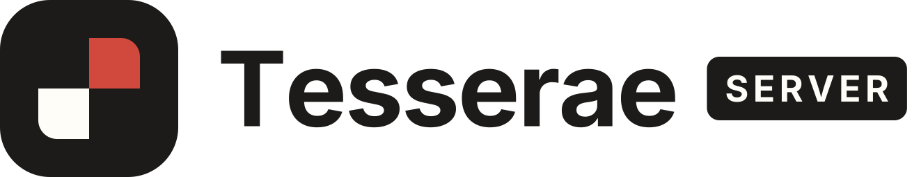
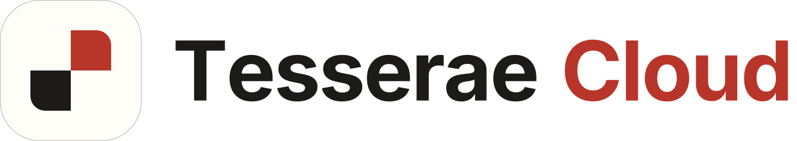
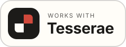
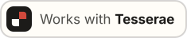

# Tesserae brand assets

Logos, wordmarks and the "Works with Tesserae" badge for
[Tesserae](https://github.com/dmellok/tesserae), as SVG and as PNG at a range
of sizes. Download what you need; nothing here needs building.

<p>
  <picture>
    <source media="(prefers-color-scheme: dark)" srcset="wordmarks/server-on-dark.svg">
    
  </picture>
  &nbsp;&nbsp;&nbsp;
  <picture>
    <source media="(prefers-color-scheme: dark)" srcset="wordmarks/cloud-on-dark.svg">
    
  </picture>
</p>
<p>
  <picture>
    <source media="(prefers-color-scheme: dark)" srcset="badges/works-with-tesserae-stacked-on-dark.svg">
    
  </picture>
  &nbsp;&nbsp;
  <picture>
    <source media="(prefers-color-scheme: dark)" srcset="badges/works-with-tesserae-inline-on-dark.svg">
    
  </picture>
</p>

## Which file do I want?

Every asset comes in two versions. The plain name is for **light**
backgrounds; `-on-dark` is for **dark** backgrounds. Prefer the SVG wherever
it is accepted, and a PNG at or above the size you will display otherwise.

| I need… | Use |
| --- | --- |
| The logo on its own | [`marks/server.svg`](marks/server.svg), or a PNG from [`marks/png/`](marks/png) |
| The logo with the name | [`wordmarks/server.svg`](wordmarks/server.svg), or a PNG from [`wordmarks/png/`](wordmarks/png) |
| To say my product works with Tesserae | [`badges/`](badges), see [the badge](#works-with-tesserae-badge) |
| An app or home-screen icon | `marks/png/server-square-*.png` (full bleed, the platform rounds it) |
| A website favicon | [`marks/server-favicon.svg`](marks/server-favicon.svg) with [`marks/server-favicon.ico`](marks/server-favicon.ico) as the fallback |

"Tesserae" on its own means the self-hosted server, so use the **server**
files unless you are specifically talking about Tesserae Cloud, the hosted
service, which has its own `cloud` files.

## What is in here

### Marks (`marks/`)

The mark is a rounded tile holding two squares. The two products use the same
drawing with opposite tiles.

| File | What it is |
| --- | --- |
| `server.svg`, `server-on-dark.svg` | Tesserae Server: ink tile, red top right, paper bottom left |
| `cloud.svg`, `cloud-on-dark.svg` | Tesserae Cloud: paper tile, red top right, ink bottom left |
| `server-square.svg`, `cloud-square.svg` | The same marks full bleed with square corners, for iOS and Android icons |
| `server-favicon.svg`, `cloud-favicon.svg` | Tab icons that adapt to the browser's light or dark theme |
| `server-favicon.ico`, `cloud-favicon.ico` | 16, 32 and 48 px in one `.ico` |

PNGs in `marks/png/`, transparent outside the tile:

- Rounded marks, as `<name>-<size>.png`: 16, 24, 32, 48, 64, 96, 128, 180,
  192, 256, 384, 512 and 1024 px.
- Square marks, as `<name>-square-<size>.png`: 180, 192, 512 and 1024 px.

The only difference between a mark and its `-on-dark` version is a 1 px
hairline around the tile, which keeps the ink server tile visible on a dark
background and the paper cloud tile visible on a light one.

### Wordmarks (`wordmarks/`)

The mark with the product name beside it: `server.svg`, `server-on-dark.svg`,
`cloud.svg` and `cloud-on-dark.svg`. The text is outlined, so no font is
needed.

PNGs in `wordmarks/png/` are named by height, as `<name>-h<height>.png`: 32,
48, 64, 96, 128, 256 and 512 px tall, on a transparent background.

### Works with Tesserae badge

For hardware makers and compatibility listings, in `badges/`:

| File | Size | For |
| --- | --- | --- |
| `works-with-tesserae-stacked.svg` | 255 × 96 | Product pages, packaging, anywhere with room |
| `works-with-tesserae-inline.svg` | 235 × 48 | Tables, footers, tight rows |

Each has an `-on-dark` version. PNGs in `badges/png/` come at 1x, 2x
(`@2x`), 3x and 4x of those sizes. The badge carries its own background and
border, so it can sit on any colour; pick the version that matches the
surface around it.

To embed it in a web page or README and have it follow the reader's theme:

```html
<a href="https://github.com/dmellok/tesserae">
  <picture>
    <source media="(prefers-color-scheme: dark)"
            srcset="https://raw.githubusercontent.com/dmellok/tesserae-brand/main/badges/works-with-tesserae-inline-on-dark.svg">
    
  </picture>
</a>
```

## Colours

| Name | Hex | Used for |
| --- | --- | --- |
| Ink | `#1C1B19` | Server tile, text on light |
| Paper | `#FFFDF8` | Cloud tile, light backgrounds |
| Bone | `#EDE9DF` | Text and hairlines on dark |
| Red (server) | `#D0493C` | The red square on the ink tile |
| Red (cloud) | `#B8352A` | The red square on the paper tile, and "Cloud" in the wordmark |

The typeface is [Inter](https://rsms.me/inter/).

## Using the assets

- Use the files as they are. Do not recolour, stretch, rotate, crop or
  redraw them, and do not add effects.
- The tile colours never change with the theme. On a dark background use the
  `-on-dark` file rather than inverting the logo.
- Leave clear space around a logo of at least a quarter of the tile's
  height, and do not show the mark smaller than 16 px.
- Use the badge only for a product that does work with Tesserae, and do not
  use any of these assets in a way that suggests Tesserae made or endorses
  your product.

## Regenerating the PNGs

The SVGs are the source of truth; every PNG and `.ico` is generated from
them by [`scripts/render.py`](scripts/render.py) and committed. After
changing or adding an SVG:

```sh
uv run scripts/render.py
```

The script needs [uv](https://docs.astral.sh/uv/) and Playwright's Chromium
(`uv run --with 'playwright>=1.60,<1.61' playwright install chromium`, once).
